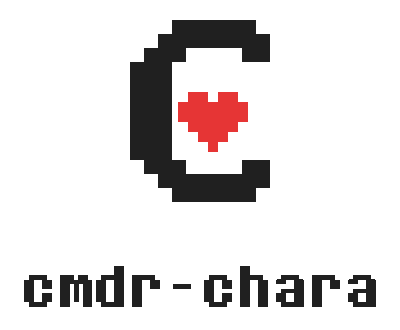
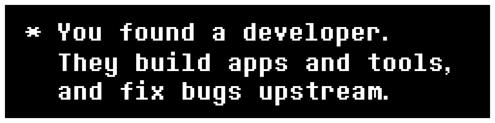
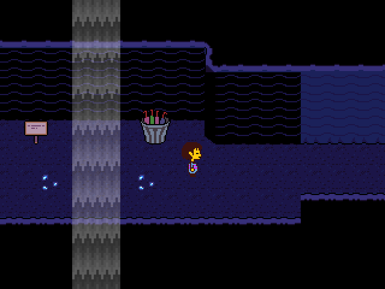

  <picture>
    <source media="(prefers-color-scheme: dark)" srcset="assets/cmdr-chara-logo-dark.svg" />
    
  </picture>

  

I build apps and developer tools, and contribute fixes upstream.

Rust · TypeScript · Flutter · Python · C#

## My portfolio

Explore my projects, skills and open-source contributions through a small Undertale-inspired game. Click the preview to play in your browser.

  <a href="https://cmdr-chara.github.io/cmdr-chara/">
    <picture>
      <source media="(prefers-reduced-motion: reduce)" srcset="assets/portfolio-preview.png" />
      
    </picture>
  </a>
   
  <a href="https://cmdr-chara.github.io/cmdr-chara/"><strong>♥ Click to play · IT / EN</strong></a>

Prefer reading? The projects, contributions and contact link are right below.

## Projects

- [Deltamod Community](https://github.com/cmdr-chara/deltamod-community) — community-maintained mod manager ([demo](https://github.com/cmdr-chara/deltamod-community#see-it-in-action), [fork & attribution](https://github.com/cmdr-chara/deltamod-community#about-this-community-fork)).
- [speedtest-cli](https://github.com/cmdr-chara/speedtest-cli) — Rust terminal tool for measuring speed, latency and bufferbloat ([screenshots](https://github.com/cmdr-chara/speedtest-cli#why-use-it), [downloads](https://github.com/cmdr-chara/speedtest-cli/releases/latest)).
- [OpenJobScout](https://github.com/cmdr-chara/open-job-scout) — job discovery and application tracking with a Rust terminal interface, Python CLI and shared SQLite storage ([downloads](https://github.com/cmdr-chara/open-job-scout/releases/latest)). Currently in alpha.
- [LeaveFlow](https://github.com/cmdr-chara/LeaveFlow) — leave-request and approval demo built with Django, Vue and PostgreSQL, including team permissions and notifications ([screenshots & setup](https://github.com/cmdr-chara/LeaveFlow#readme)).
- [Smart Building Controller](https://github.com/cmdr-chara/smart-building-controller) — smart-building prototype connecting a Flutter app, PHP API and Arduino/ESP32 sensors ([Android download](https://github.com/cmdr-chara/smart-building-controller/releases/tag/latest)).

More tools: [Chara's Toolkit](https://github.com/cmdr-chara/chara-toolkit) · [PulseDock](https://github.com/cmdr-chara/PulseDock)

## Contributions

- [Zed](https://github.com/zed-industries/zed/pull/63766) — fixed character counting in skill descriptions.
- [TestSprite CLI](https://github.com/TestSprite/testsprite-cli/pull/118) — preserved typed input between terminal prompts.

[All merged contributions](https://github.com/search?q=is%3Apr+is%3Amerged+author%3Acmdr-chara+-user%3Acmdr-chara&type=pullrequests)

## Contact

[Find me on GitHub](https://github.com/cmdr-chara).
